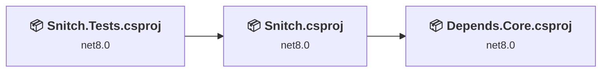
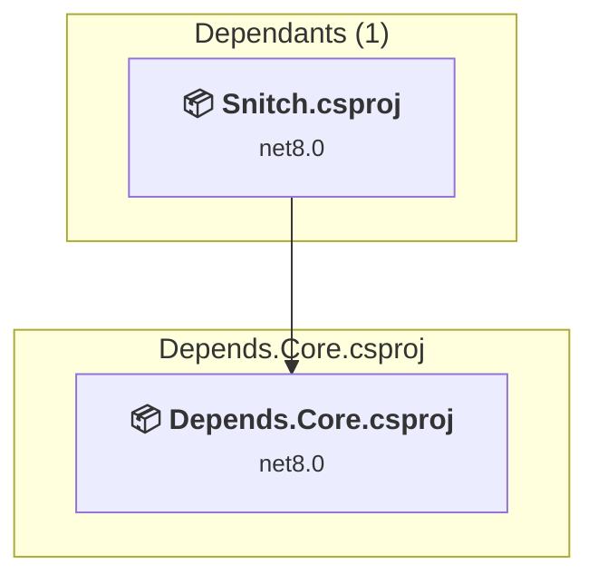
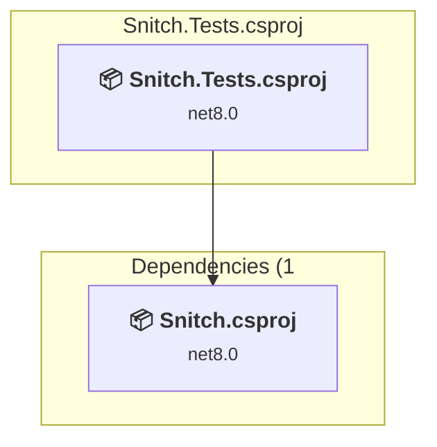
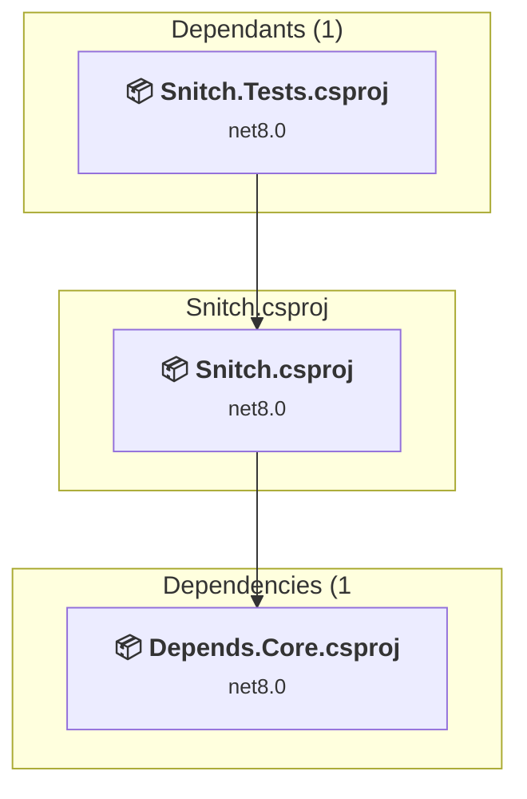

# Projects and dependencies analysis

This document provides a comprehensive overview of the projects and their dependencies in the context of upgrading to .NETCoreApp,Version=v10.0.

## Table of Contents

- [Executive Summary](#executive-Summary)
  - [Highlevel Metrics](#highlevel-metrics)
  - [Projects Compatibility](#projects-compatibility)
  - [Package Compatibility](#package-compatibility)
  - [API Compatibility](#api-compatibility)
  - [Binding Redirect Configuration](#binding-redirect-configuration)
- [Aggregate NuGet packages details](#aggregate-nuget-packages-details)
- [Top API Migration Challenges](#top-api-migration-challenges)
  - [Technologies and Features](#technologies-and-features)
  - [Most Frequent API Issues](#most-frequent-api-issues)
- [Projects Relationship Graph](#projects-relationship-graph)
- [Project Details](#project-details)

  - [Depends.Core\Depends.Core.csproj](#dependscoredependscorecsproj)
  - [Snitch.Tests\Snitch.Tests.csproj](#snitchtestssnitchtestscsproj)
  - [Snitch\Snitch.csproj](#snitchsnitchcsproj)

## Executive Summary

### Highlevel Metrics

| Metric | Count | Status |
| :--- | :---: | :--- |
| Total Projects | 3 | All require upgrade |
| Total NuGet Packages | 101 | 3 need upgrade |
| Total Code Files | 34 |  |
| Total Code Files with Incidents | 3 |  |
| Total Lines of Code | 2288 |  |
| Total Number of Issues | 6 |  |
| Estimated LOC to modify | 0+ | at least 0.0% of codebase |

### Projects Compatibility

| Project | Target Framework | Difficulty | Package Issues | API Issues | Binding Issues | Est. LOC Impact | Description |
| :--- | :---: | :---: | :---: | :---: | :---: | :---: | :--- |
| [Depends.Core\Depends.Core.csproj](#dependscoredependscorecsproj) | net8.0 | 🟢 Low | 1 | 0 | 0 |  | ClassLibrary, Sdk Style = True |
| [Snitch.Tests\Snitch.Tests.csproj](#snitchtestssnitchtestscsproj) | net8.0 | 🟢 Low | 2 | 0 | 0 |  | DotNetCoreApp, Sdk Style = True |
| [Snitch\Snitch.csproj](#snitchsnitchcsproj) | net8.0 | 🟢 Low | 0 | 0 | 0 |  | DotNetCoreApp, Sdk Style = True |

### Package Compatibility

| Status | Count | Percentage |
| :--- | :---: | :---: |
| ✅ Compatible | 98 | 97.0% |
| ⚠️ Incompatible | 2 | 2.0% |
| 🔄 Upgrade Recommended | 1 | 1.0% |
| ***Total NuGet Packages*** | ***101*** | ***100%*** |

### API Compatibility

| Category | Count | Impact |
| :--- | :---: | :--- |
| 🔴 Binary Incompatible | 0 | High - Require code changes |
| 🟡 Source Incompatible | 0 | Medium - Needs re-compilation and potential conflicting API error fixing |
| 🔵 Behavioral change | 0 | Low - Behavioral changes that may require testing at runtime |
| ✅ Compatible | 2468 |  |
| ***Total APIs Analyzed*** | ***2468*** |  |

## Aggregate NuGet packages details

| Package | Current Version | Suggested Version | Projects | Description |
| :--- | :---: | :---: | :--- | :--- |
| Autofac | 8.1.0 |  | [Snitch.csproj](#snitchsnitchcsproj) [Snitch.Tests.csproj](#snitchtestssnitchtestscsproj) | ✅Compatible |
| Buildalyzer | 7.0.2 |  | [Depends.Core.csproj](#dependscoredependscorecsproj) [Snitch.csproj](#snitchsnitchcsproj) [Snitch.Tests.csproj](#snitchtestssnitchtestscsproj) | ✅Compatible |
| Buildalyzer.Logger | 7.0.2 |  | [Depends.Core.csproj](#dependscoredependscorecsproj) [Snitch.csproj](#snitchsnitchcsproj) [Snitch.Tests.csproj](#snitchtestssnitchtestscsproj) | ✅Compatible |
| DiffEngine | 11.3.0 |  | [Snitch.Tests.csproj](#snitchtestssnitchtestscsproj) | ✅Compatible |
| EmptyFiles | 4.4.0 |  | [Snitch.Tests.csproj](#snitchtestssnitchtestscsproj) | ✅Compatible |
| MarkdownSnippets.MsBuild | 27.0.2 |  | [Snitch.Tests.csproj](#snitchtestssnitchtestscsproj) | ✅Compatible |
| Microsoft.Build | 17.11.4 | 18.9.6 | [Depends.Core.csproj](#dependscoredependscorecsproj) [Snitch.csproj](#snitchsnitchcsproj) [Snitch.Tests.csproj](#snitchtestssnitchtestscsproj) | NuGet package contains security vulnerability |
| Microsoft.Build.Framework | 17.11.4 |  | [Depends.Core.csproj](#dependscoredependscorecsproj) [Snitch.csproj](#snitchsnitchcsproj) [Snitch.Tests.csproj](#snitchtestssnitchtestscsproj) | ✅Compatible |
| Microsoft.Build.Tasks.Core | 17.0.1 |  | [Depends.Core.csproj](#dependscoredependscorecsproj) [Snitch.csproj](#snitchsnitchcsproj) [Snitch.Tests.csproj](#snitchtestssnitchtestscsproj) | ✅Compatible |
| Microsoft.Build.Utilities.Core | 17.0.1 |  | [Depends.Core.csproj](#dependscoredependscorecsproj) [Snitch.csproj](#snitchsnitchcsproj) [Snitch.Tests.csproj](#snitchtestssnitchtestscsproj) | ✅Compatible |
| Microsoft.CodeAnalysis.Analyzers | 3.3.2 |  | [Depends.Core.csproj](#dependscoredependscorecsproj) [Snitch.csproj](#snitchsnitchcsproj) [Snitch.Tests.csproj](#snitchtestssnitchtestscsproj) | ✅Compatible |
| Microsoft.CodeAnalysis.Common | 4.0.0 |  | [Depends.Core.csproj](#dependscoredependscorecsproj) [Snitch.csproj](#snitchsnitchcsproj) [Snitch.Tests.csproj](#snitchtestssnitchtestscsproj) | ✅Compatible |
| Microsoft.CodeAnalysis.CSharp | 4.0.0 |  | [Depends.Core.csproj](#dependscoredependscorecsproj) [Snitch.csproj](#snitchsnitchcsproj) [Snitch.Tests.csproj](#snitchtestssnitchtestscsproj) | ✅Compatible |
| Microsoft.CodeAnalysis.NetAnalyzers | 8.0.0 |  | [Snitch.csproj](#snitchsnitchcsproj) | ✅Compatible |
| Microsoft.CodeAnalysis.VisualBasic | 4.0.0 |  | [Depends.Core.csproj](#dependscoredependscorecsproj) [Snitch.csproj](#snitchsnitchcsproj) [Snitch.Tests.csproj](#snitchtestssnitchtestscsproj) | ✅Compatible |
| Microsoft.CodeCoverage | 17.11.1 |  | [Snitch.Tests.csproj](#snitchtestssnitchtestscsproj) | ✅Compatible |
| Microsoft.Extensions.DependencyInjection | 6.0.0 |  | [Depends.Core.csproj](#dependscoredependscorecsproj) [Snitch.csproj](#snitchsnitchcsproj) [Snitch.Tests.csproj](#snitchtestssnitchtestscsproj) | ✅Compatible |
| Microsoft.Extensions.DependencyInjection.Abstractions | 6.0.0 |  | [Depends.Core.csproj](#dependscoredependscorecsproj) [Snitch.csproj](#snitchsnitchcsproj) [Snitch.Tests.csproj](#snitchtestssnitchtestscsproj) | ✅Compatible |
| Microsoft.Extensions.Logging | 6.0.0 |  | [Depends.Core.csproj](#dependscoredependscorecsproj) [Snitch.csproj](#snitchsnitchcsproj) [Snitch.Tests.csproj](#snitchtestssnitchtestscsproj) | ✅Compatible |
| Microsoft.Extensions.Logging.Abstractions | 6.0.0 |  | [Depends.Core.csproj](#dependscoredependscorecsproj) [Snitch.csproj](#snitchsnitchcsproj) [Snitch.Tests.csproj](#snitchtestssnitchtestscsproj) | ✅Compatible |
| Microsoft.Extensions.Options | 6.0.0 |  | [Depends.Core.csproj](#dependscoredependscorecsproj) [Snitch.csproj](#snitchsnitchcsproj) [Snitch.Tests.csproj](#snitchtestssnitchtestscsproj) | ✅Compatible |
| Microsoft.Extensions.Primitives | 6.0.0 |  | [Depends.Core.csproj](#dependscoredependscorecsproj) [Snitch.csproj](#snitchsnitchcsproj) [Snitch.Tests.csproj](#snitchtestssnitchtestscsproj) | ✅Compatible |
| Microsoft.NET.StringTools | 17.11.4 |  | [Depends.Core.csproj](#dependscoredependscorecsproj) [Snitch.csproj](#snitchsnitchcsproj) [Snitch.Tests.csproj](#snitchtestssnitchtestscsproj) | ✅Compatible |
| Microsoft.NET.Test.Sdk | 17.11.1 |  | [Snitch.Tests.csproj](#snitchtestssnitchtestscsproj) | ✅Compatible |
| Microsoft.NETCore.Platforms | 3.1.0 |  | [Depends.Core.csproj](#dependscoredependscorecsproj) [Snitch.csproj](#snitchsnitchcsproj) [Snitch.Tests.csproj](#snitchtestssnitchtestscsproj) | ✅Compatible |
| Microsoft.NETCore.Targets | 1.1.0 |  | [Depends.Core.csproj](#dependscoredependscorecsproj) [Snitch.csproj](#snitchsnitchcsproj) [Snitch.Tests.csproj](#snitchtestssnitchtestscsproj) | ✅Compatible |
| Microsoft.TestPlatform.ObjectModel | 17.11.1 |  | [Snitch.Tests.csproj](#snitchtestssnitchtestscsproj) | ✅Compatible |
| Microsoft.TestPlatform.TestHost | 17.11.1 |  | [Snitch.Tests.csproj](#snitchtestssnitchtestscsproj) | ✅Compatible |
| Microsoft.Win32.Registry | 4.3.0 |  | [Depends.Core.csproj](#dependscoredependscorecsproj) [Snitch.csproj](#snitchsnitchcsproj) [Snitch.Tests.csproj](#snitchtestssnitchtestscsproj) | ✅Compatible |
| Microsoft.Win32.SystemEvents | 4.7.0 |  | [Depends.Core.csproj](#dependscoredependscorecsproj) [Snitch.csproj](#snitchsnitchcsproj) [Snitch.Tests.csproj](#snitchtestssnitchtestscsproj) | ✅Compatible |
| MinVer | 4.3.0 |  | [Depends.Core.csproj](#dependscoredependscorecsproj) | ✅Compatible |
| MSBuild.StructuredLogger | 2.1.815 |  | [Depends.Core.csproj](#dependscoredependscorecsproj) [Snitch.csproj](#snitchsnitchcsproj) [Snitch.Tests.csproj](#snitchtestssnitchtestscsproj) | ✅Compatible |
| MsBuildPipeLogger.Server | 1.1.6 |  | [Depends.Core.csproj](#dependscoredependscorecsproj) [Snitch.csproj](#snitchsnitchcsproj) [Snitch.Tests.csproj](#snitchtestssnitchtestscsproj) | ✅Compatible |
| Newtonsoft.Json | 13.0.3 |  | [Depends.Core.csproj](#dependscoredependscorecsproj) [Snitch.csproj](#snitchsnitchcsproj) [Snitch.Tests.csproj](#snitchtestssnitchtestscsproj) | ✅Compatible |
| NuGet.Common | 6.11.1 |  | [Depends.Core.csproj](#dependscoredependscorecsproj) [Snitch.csproj](#snitchsnitchcsproj) [Snitch.Tests.csproj](#snitchtestssnitchtestscsproj) | ✅Compatible |
| NuGet.Configuration | 6.11.1 |  | [Depends.Core.csproj](#dependscoredependscorecsproj) [Snitch.csproj](#snitchsnitchcsproj) [Snitch.Tests.csproj](#snitchtestssnitchtestscsproj) | ✅Compatible |
| NuGet.DependencyResolver.Core | 6.11.1 |  | [Depends.Core.csproj](#dependscoredependscorecsproj) [Snitch.csproj](#snitchsnitchcsproj) [Snitch.Tests.csproj](#snitchtestssnitchtestscsproj) | ✅Compatible |
| NuGet.Frameworks | 6.11.1 |  | [Depends.Core.csproj](#dependscoredependscorecsproj) [Snitch.csproj](#snitchsnitchcsproj) [Snitch.Tests.csproj](#snitchtestssnitchtestscsproj) | ✅Compatible |
| NuGet.LibraryModel | 6.11.1 |  | [Depends.Core.csproj](#dependscoredependscorecsproj) [Snitch.csproj](#snitchsnitchcsproj) [Snitch.Tests.csproj](#snitchtestssnitchtestscsproj) | ✅Compatible |
| NuGet.Packaging | 6.11.1 |  | [Depends.Core.csproj](#dependscoredependscorecsproj) [Snitch.csproj](#snitchsnitchcsproj) [Snitch.Tests.csproj](#snitchtestssnitchtestscsproj) | ✅Compatible |
| NuGet.ProjectModel | 6.11.1 |  | [Depends.Core.csproj](#dependscoredependscorecsproj) [Snitch.csproj](#snitchsnitchcsproj) [Snitch.Tests.csproj](#snitchtestssnitchtestscsproj) | ✅Compatible |
| NuGet.Protocol | 6.11.1 |  | [Depends.Core.csproj](#dependscoredependscorecsproj) [Snitch.csproj](#snitchsnitchcsproj) [Snitch.Tests.csproj](#snitchtestssnitchtestscsproj) | ✅Compatible |
| NuGet.Resolver | 6.11.1 |  | [Depends.Core.csproj](#dependscoredependscorecsproj) [Snitch.csproj](#snitchsnitchcsproj) [Snitch.Tests.csproj](#snitchtestssnitchtestscsproj) | ✅Compatible |
| NuGet.Versioning | 6.11.1 |  | [Depends.Core.csproj](#dependscoredependscorecsproj) [Snitch.csproj](#snitchsnitchcsproj) [Snitch.Tests.csproj](#snitchtestssnitchtestscsproj) | ✅Compatible |
| Roslynator.Analyzers | 3.3.0 |  | [Snitch.csproj](#snitchsnitchcsproj) | ✅Compatible |
| Shouldly | 4.2.1 |  | [Snitch.Tests.csproj](#snitchtestssnitchtestscsproj) | ✅Compatible |
| SimpleExec | 8.0.0 |  | [Snitch.Tests.csproj](#snitchtestssnitchtestscsproj) | ✅Compatible |
| SimpleInfoName | 1.1.1 |  | [Snitch.Tests.csproj](#snitchtestssnitchtestscsproj) | ✅Compatible |
| Spectre.Console | 0.43.0 |  | [Snitch.csproj](#snitchsnitchcsproj) [Snitch.Tests.csproj](#snitchtestssnitchtestscsproj) | ✅Compatible |
| Spectre.Console.Testing | 0.43.0 |  | [Snitch.Tests.csproj](#snitchtestssnitchtestscsproj) | ✅Compatible |
| Spectre.Verify.Extensions | 0.5.0 |  | [Snitch.Tests.csproj](#snitchtestssnitchtestscsproj) | ✅Compatible |
| StyleCop.Analyzers | 1.2.0-beta.66 |  | [Snitch.csproj](#snitchsnitchcsproj) | ✅Compatible |
| StyleCop.Analyzers.Unstable | 1.2.0.66 |  | [Snitch.csproj](#snitchsnitchcsproj) | ✅Compatible |
| System.CodeDom | 4.4.0 |  | [Depends.Core.csproj](#dependscoredependscorecsproj) [Snitch.csproj](#snitchsnitchcsproj) | ✅Compatible |
| System.CodeDom | 6.0.0 |  | [Snitch.Tests.csproj](#snitchtestssnitchtestscsproj) | ✅Compatible |
| System.Collections | 4.3.0 |  | [Depends.Core.csproj](#dependscoredependscorecsproj) [Snitch.csproj](#snitchsnitchcsproj) [Snitch.Tests.csproj](#snitchtestssnitchtestscsproj) | ✅Compatible |
| System.Collections.Immutable | 8.0.0 |  | [Depends.Core.csproj](#dependscoredependscorecsproj) [Snitch.csproj](#snitchsnitchcsproj) [Snitch.Tests.csproj](#snitchtestssnitchtestscsproj) | ✅Compatible |
| System.Configuration.ConfigurationManager | 8.0.0 |  | [Depends.Core.csproj](#dependscoredependscorecsproj) [Snitch.csproj](#snitchsnitchcsproj) [Snitch.Tests.csproj](#snitchtestssnitchtestscsproj) | ✅Compatible |
| System.Diagnostics.DiagnosticSource | 6.0.0 |  | [Depends.Core.csproj](#dependscoredependscorecsproj) | ✅Compatible |
| System.Diagnostics.DiagnosticSource | 8.0.1 |  | [Snitch.csproj](#snitchsnitchcsproj) [Snitch.Tests.csproj](#snitchtestssnitchtestscsproj) | ✅Compatible |
| System.Diagnostics.EventLog | 8.0.0 |  | [Depends.Core.csproj](#dependscoredependscorecsproj) [Snitch.csproj](#snitchsnitchcsproj) [Snitch.Tests.csproj](#snitchtestssnitchtestscsproj) | ✅Compatible |
| System.Drawing.Common | 4.7.0 |  | [Depends.Core.csproj](#dependscoredependscorecsproj) [Snitch.csproj](#snitchsnitchcsproj) [Snitch.Tests.csproj](#snitchtestssnitchtestscsproj) | ✅Compatible |
| System.Formats.Asn1 | 6.0.0 |  | [Depends.Core.csproj](#dependscoredependscorecsproj) [Snitch.csproj](#snitchsnitchcsproj) [Snitch.Tests.csproj](#snitchtestssnitchtestscsproj) | ✅Compatible |
| System.Globalization | 4.3.0 |  | [Depends.Core.csproj](#dependscoredependscorecsproj) [Snitch.csproj](#snitchsnitchcsproj) [Snitch.Tests.csproj](#snitchtestssnitchtestscsproj) | ✅Compatible |
| System.IO | 4.3.0 |  | [Depends.Core.csproj](#dependscoredependscorecsproj) [Snitch.csproj](#snitchsnitchcsproj) [Snitch.Tests.csproj](#snitchtestssnitchtestscsproj) | ✅Compatible |
| System.Management | 6.0.1 |  | [Snitch.Tests.csproj](#snitchtestssnitchtestscsproj) | ✅Compatible |
| System.Memory | 4.5.4 |  | [Depends.Core.csproj](#dependscoredependscorecsproj) [Snitch.csproj](#snitchsnitchcsproj) [Snitch.Tests.csproj](#snitchtestssnitchtestscsproj) | ✅Compatible |
| System.Reflection | 4.3.0 |  | [Depends.Core.csproj](#dependscoredependscorecsproj) [Snitch.csproj](#snitchsnitchcsproj) [Snitch.Tests.csproj](#snitchtestssnitchtestscsproj) | ✅Compatible |
| System.Reflection.Metadata | 8.0.0 |  | [Depends.Core.csproj](#dependscoredependscorecsproj) [Snitch.csproj](#snitchsnitchcsproj) [Snitch.Tests.csproj](#snitchtestssnitchtestscsproj) | ✅Compatible |
| System.Reflection.MetadataLoadContext | 8.0.0 |  | [Depends.Core.csproj](#dependscoredependscorecsproj) [Snitch.csproj](#snitchsnitchcsproj) [Snitch.Tests.csproj](#snitchtestssnitchtestscsproj) | ✅Compatible |
| System.Reflection.Primitives | 4.3.0 |  | [Depends.Core.csproj](#dependscoredependscorecsproj) [Snitch.csproj](#snitchsnitchcsproj) [Snitch.Tests.csproj](#snitchtestssnitchtestscsproj) | ✅Compatible |
| System.Resources.Extensions | 4.6.0 |  | [Depends.Core.csproj](#dependscoredependscorecsproj) [Snitch.csproj](#snitchsnitchcsproj) [Snitch.Tests.csproj](#snitchtestssnitchtestscsproj) | ✅Compatible |
| System.Resources.ResourceManager | 4.3.0 |  | [Depends.Core.csproj](#dependscoredependscorecsproj) [Snitch.csproj](#snitchsnitchcsproj) [Snitch.Tests.csproj](#snitchtestssnitchtestscsproj) | ✅Compatible |
| System.Runtime | 4.3.0 |  | [Depends.Core.csproj](#dependscoredependscorecsproj) [Snitch.csproj](#snitchsnitchcsproj) [Snitch.Tests.csproj](#snitchtestssnitchtestscsproj) | ✅Compatible |
| System.Runtime.CompilerServices.Unsafe | 6.0.0 |  | [Depends.Core.csproj](#dependscoredependscorecsproj) [Snitch.csproj](#snitchsnitchcsproj) [Snitch.Tests.csproj](#snitchtestssnitchtestscsproj) | ✅Compatible |
| System.Runtime.Extensions | 4.3.0 |  | [Depends.Core.csproj](#dependscoredependscorecsproj) [Snitch.csproj](#snitchsnitchcsproj) [Snitch.Tests.csproj](#snitchtestssnitchtestscsproj) | ✅Compatible |
| System.Runtime.Handles | 4.3.0 |  | [Depends.Core.csproj](#dependscoredependscorecsproj) [Snitch.csproj](#snitchsnitchcsproj) [Snitch.Tests.csproj](#snitchtestssnitchtestscsproj) | ✅Compatible |
| System.Runtime.InteropServices | 4.3.0 |  | [Depends.Core.csproj](#dependscoredependscorecsproj) [Snitch.csproj](#snitchsnitchcsproj) [Snitch.Tests.csproj](#snitchtestssnitchtestscsproj) | ✅Compatible |
| System.Security.AccessControl | 4.7.0 |  | [Depends.Core.csproj](#dependscoredependscorecsproj) [Snitch.csproj](#snitchsnitchcsproj) [Snitch.Tests.csproj](#snitchtestssnitchtestscsproj) | ✅Compatible |
| System.Security.Cryptography.Pkcs | 6.0.4 |  | [Depends.Core.csproj](#dependscoredependscorecsproj) [Snitch.csproj](#snitchsnitchcsproj) [Snitch.Tests.csproj](#snitchtestssnitchtestscsproj) | ✅Compatible |
| System.Security.Cryptography.ProtectedData | 8.0.0 |  | [Depends.Core.csproj](#dependscoredependscorecsproj) [Snitch.csproj](#snitchsnitchcsproj) [Snitch.Tests.csproj](#snitchtestssnitchtestscsproj) | ✅Compatible |
| System.Security.Cryptography.Xml | 4.7.0 |  | [Depends.Core.csproj](#dependscoredependscorecsproj) [Snitch.csproj](#snitchsnitchcsproj) [Snitch.Tests.csproj](#snitchtestssnitchtestscsproj) | ✅Compatible |
| System.Security.Permissions | 4.7.0 |  | [Depends.Core.csproj](#dependscoredependscorecsproj) [Snitch.csproj](#snitchsnitchcsproj) [Snitch.Tests.csproj](#snitchtestssnitchtestscsproj) | ✅Compatible |
| System.Security.Principal.Windows | 4.7.0 |  | [Depends.Core.csproj](#dependscoredependscorecsproj) [Snitch.csproj](#snitchsnitchcsproj) [Snitch.Tests.csproj](#snitchtestssnitchtestscsproj) | ✅Compatible |
| System.Text.Encoding | 4.3.0 |  | [Depends.Core.csproj](#dependscoredependscorecsproj) [Snitch.csproj](#snitchsnitchcsproj) [Snitch.Tests.csproj](#snitchtestssnitchtestscsproj) | ✅Compatible |
| System.Text.Encoding.CodePages | 4.5.1 |  | [Depends.Core.csproj](#dependscoredependscorecsproj) [Snitch.csproj](#snitchsnitchcsproj) [Snitch.Tests.csproj](#snitchtestssnitchtestscsproj) | ✅Compatible |
| System.Threading.Tasks | 4.3.0 |  | [Depends.Core.csproj](#dependscoredependscorecsproj) [Snitch.csproj](#snitchsnitchcsproj) [Snitch.Tests.csproj](#snitchtestssnitchtestscsproj) | ✅Compatible |
| System.Threading.Tasks.Dataflow | 4.9.0 |  | [Depends.Core.csproj](#dependscoredependscorecsproj) [Snitch.csproj](#snitchsnitchcsproj) [Snitch.Tests.csproj](#snitchtestssnitchtestscsproj) | ✅Compatible |
| System.Threading.Tasks.Extensions | 4.5.4 |  | [Depends.Core.csproj](#dependscoredependscorecsproj) [Snitch.csproj](#snitchsnitchcsproj) [Snitch.Tests.csproj](#snitchtestssnitchtestscsproj) | ✅Compatible |
| System.Windows.Extensions | 4.7.0 |  | [Depends.Core.csproj](#dependscoredependscorecsproj) [Snitch.csproj](#snitchsnitchcsproj) [Snitch.Tests.csproj](#snitchtestssnitchtestscsproj) | ✅Compatible |
| TextCopy | 4.3.1 |  | [Snitch.Tests.csproj](#snitchtestssnitchtestscsproj) | ✅Compatible |
| Verify | 14.11.4 |  | [Snitch.Tests.csproj](#snitchtestssnitchtestscsproj) | ✅Compatible |
| Verify.Xunit | 14.11.4 |  | [Snitch.Tests.csproj](#snitchtestssnitchtestscsproj) | ⚠️NuGet package is deprecated |
| xunit | 2.9.2 |  | [Snitch.Tests.csproj](#snitchtestssnitchtestscsproj) | ⚠️NuGet package is deprecated |
| xunit.abstractions | 2.0.3 |  | [Snitch.Tests.csproj](#snitchtestssnitchtestscsproj) | ✅Compatible |
| xunit.analyzers | 1.16.0 |  | [Snitch.Tests.csproj](#snitchtestssnitchtestscsproj) | ✅Compatible |
| xunit.assert | 2.9.2 |  | [Snitch.Tests.csproj](#snitchtestssnitchtestscsproj) | ✅Compatible |
| xunit.core | 2.9.2 |  | [Snitch.Tests.csproj](#snitchtestssnitchtestscsproj) | ✅Compatible |
| xunit.extensibility.core | 2.9.2 |  | [Snitch.Tests.csproj](#snitchtestssnitchtestscsproj) | ✅Compatible |
| xunit.extensibility.execution | 2.9.2 |  | [Snitch.Tests.csproj](#snitchtestssnitchtestscsproj) | ✅Compatible |
| xunit.runner.visualstudio | 2.8.2 |  | [Snitch.Tests.csproj](#snitchtestssnitchtestscsproj) | ✅Compatible |

## Top API Migration Challenges

### Technologies and Features

| Technology | Issues | Percentage | Migration Path |
| :--- | :---: | :---: | :--- |

### Most Frequent API Issues

| API | Count | Percentage | Category |
| :--- | :---: | :---: | :--- |

## Projects Relationship Graph

Legend:
📦 SDK-style project
⚙️ Classic project

## Project Details

### Depends.Core\Depends.Core.csproj

#### Project Info

- **Current Target Framework:** net8.0
- **Proposed Target Framework:** net10.0
- **SDK-style**: True
- **Project Kind:** ClassLibrary
- **Dependencies**: 0
- **Dependants**: 1
- **Number of Files**: 13
- **Number of Files with Incidents**: 1
- **Lines of Code**: 804
- **Estimated LOC to modify**: 0+ (at least 0.0% of the project)

#### Dependency Graph

Legend:
📦 SDK-style project
⚙️ Classic project

### API Compatibility

| Category | Count | Impact |
| :--- | :---: | :--- |
| 🔴 Binary Incompatible | 0 | High - Require code changes |
| 🟡 Source Incompatible | 0 | Medium - Needs re-compilation and potential conflicting API error fixing |
| 🔵 Behavioral change | 0 | Low - Behavioral changes that may require testing at runtime |
| ✅ Compatible | 872 |  |
| ***Total APIs Analyzed*** | ***872*** |  |

### Snitch.Tests\Snitch.Tests.csproj

#### Project Info

- **Current Target Framework:** net8.0
- **Proposed Target Framework:** net10.0
- **SDK-style**: True
- **Project Kind:** DotNetCoreApp
- **Dependencies**: 1
- **Dependants**: 0
- **Number of Files**: 4
- **Number of Files with Incidents**: 1
- **Lines of Code**: 256
- **Estimated LOC to modify**: 0+ (at least 0.0% of the project)

#### Dependency Graph

Legend:
📦 SDK-style project
⚙️ Classic project

### API Compatibility

| Category | Count | Impact |
| :--- | :---: | :--- |
| 🔴 Binary Incompatible | 0 | High - Require code changes |
| 🟡 Source Incompatible | 0 | Medium - Needs re-compilation and potential conflicting API error fixing |
| 🔵 Behavioral change | 0 | Low - Behavioral changes that may require testing at runtime |
| ✅ Compatible | 179 |  |
| ***Total APIs Analyzed*** | ***179*** |  |

### Snitch\Snitch.csproj

#### Project Info

- **Current Target Framework:** net8.0
- **Proposed Target Framework:** net10.0
- **SDK-style**: True
- **Project Kind:** DotNetCoreApp
- **Dependencies**: 1
- **Dependants**: 1
- **Number of Files**: 19
- **Number of Files with Incidents**: 1
- **Lines of Code**: 1228
- **Estimated LOC to modify**: 0+ (at least 0.0% of the project)

#### Dependency Graph

Legend:
📦 SDK-style project
⚙️ Classic project

### API Compatibility

| Category | Count | Impact |
| :--- | :---: | :--- |
| 🔴 Binary Incompatible | 0 | High - Require code changes |
| 🟡 Source Incompatible | 0 | Medium - Needs re-compilation and potential conflicting API error fixing |
| 🔵 Behavioral change | 0 | Low - Behavioral changes that may require testing at runtime |
| ✅ Compatible | 1417 |  |
| ***Total APIs Analyzed*** | ***1417*** |  |

